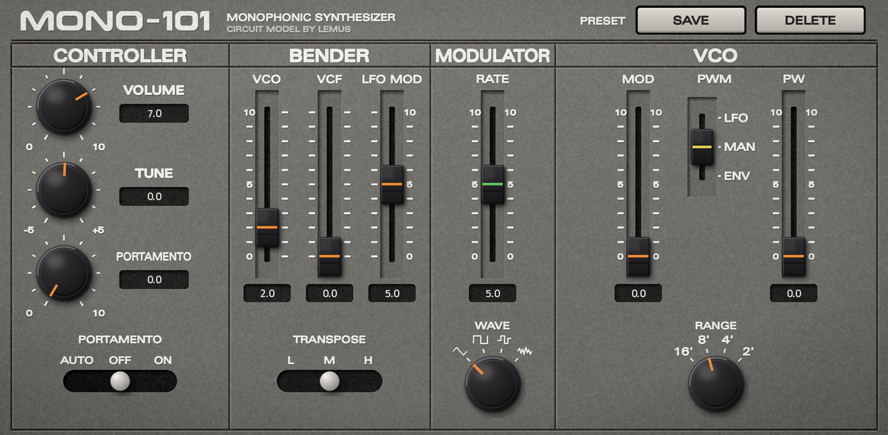
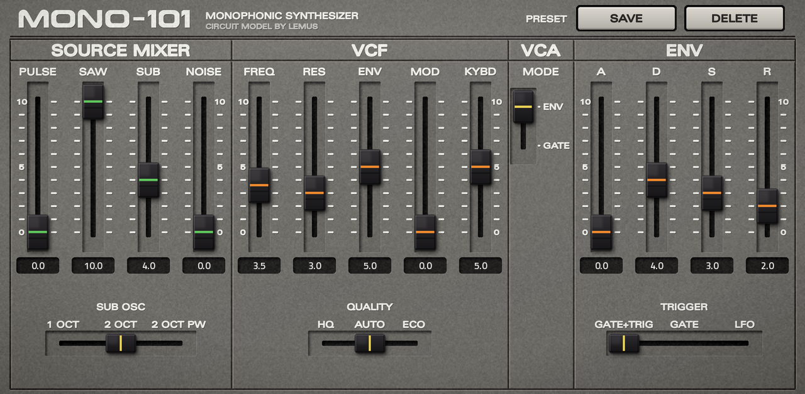
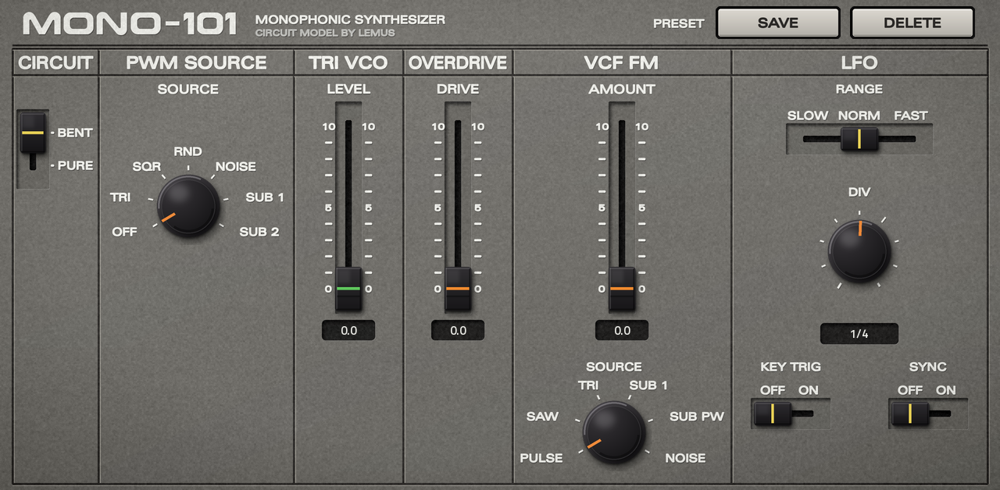
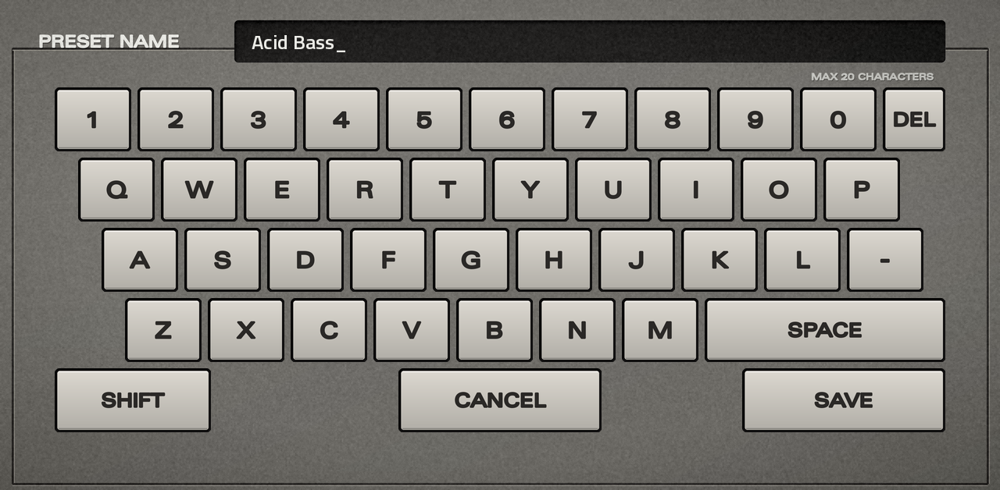

# Mono-101

A circuit-modelled SH-101 for the Akai MPC standalone, as a native plugin instrument. Its voice is not an
oscillator-and-filter imitation: every stage of the original (the CEM3340 VCO with its pulse-width and sub-oscillator
circuits, the noise source and source mixer, the IR3109 filter and its resonance loop, the envelope, the BA662 VCA,
the modulator and the bender board) is solved as a circuit from Roland's service-notes schematic. It has the
original's 40 factory sample sounds, 15 of its own, 32 user presets you name on screen, and a **Circuit Bent** page
of switchable mods.





*The skin as the build draws it (`tools/make_tui.py --preview`).*

## Where it comes from

The voice is the SH-101 machine from **[Lemus](https://github.com/lemus-dev/lemus)** (`machines/sh101`, commit
7575df4), an instrument host by the Lemus authors, licensed under AGPL-3.0. Mono-101 uses the synth board only, not
Lemus's emulated CPU board, so it needs no ROM: MIDI drives the board through Lemus's own voice mode, the way the
original keyboard's CPU would. It plays from pads, a keyboard or the MPC sequencer.

What the Lemus model covers:

- **The synth board, part by part, from the schematic:** the KCV / RANGE / TUNE pitch summer and portamento, the
  CEM3340 VCO with its saw, pulse and PWM network, the 4013 sub-oscillator, the noise generator and the source mixer,
  the IR3109 four-pole OTA filter with its CV summer, the envelope generator with its three trigger modes, the BA662
  VCA, the output stage and jack board, the MODULATOR (triangle, square, random, noise) and the bender board.
- **Solved as circuits:** the nonlinear stages (the filter's OTAs, the VCA chip, the output stage) are solved as
  circuit equations at every sample, at 4× the host rate.
- **Calibrated to a real unit:** the trims and the part values the schematic leaves open are fitted to recordings of
  a real SH-101 (the "real unit" calibration; Lemus's `docs/model.md` documents it).

Mono-101's own changes to the voice are each a separate commit in `src/lemus/` (see `src/lemus/VENDORED.md`):

- **Faster maths, same results:** inline `exp`, `tanh`, `log` and friends in the per-sample solvers. Against renders of
  the unmodified Lemus code on six test workloads the output differs by at most −121 dBFS (0.000 dB mean spectral
  change): `tools/voicetest/vtest check tools/voicetest/golden`.
- **ECO:** the filter section at 2× for slower cores (QUALITY).
- **RANDOM steps:** the MODULATOR's RANDOM wave takes a new value on each LFO clock, as the original's firmware does
  (Lemus's voice mode holds it still, having no firmware).
- **The Circuit Bent mods** (below). With every mod at zero the voice renders bit-identical to the same code without
  them.

## Features

- **VCO tab:** the CONTROLLER (VOLUME, TUNE, PORTAMENTO with AUTO / OFF / ON), the BENDER board's VCO, VCF and LFO MOD
  sliders and TRANSPOSE, the MODULATOR (RATE, WAVE) and the VCO (MOD, RANGE, PWM, PW).
- **VCF tab:** the SOURCE MIXER (PULSE, SAW, SUB, NOISE, SUB OSC mode), the VCF (FREQ, RES, ENV, MOD, KYBD), the VCA
  MODE, the ENV (A, D, S, R, TRIGGER) and QUALITY.
- **Circuit Bent tab:** mods in the spirit of the classic SH-101 mod kits, each off at zero. **CIRCUIT** switches them
  all out at once: on PURE the board is the stock SH-101, whatever the other controls say.
  - **PWM SOURCE:** another wave for the PWM switch's LFO position: triangle, square, random, noise, or the
    sub-oscillator's 1- or 2-octave square (audio-rate PWM).
  - **TRI VCO:** the CEM3340's triangle output, which the SH-101 leaves unused, as a fifth mixer source.
  - **OVERDRIVE:** the mixer into the filter up to 8× harder; the filter's OTAs do the distorting.
  - **VCF FM:** pulse, saw, triangle, sub, sub pulse or noise into the cutoff summer, at audio rate.
  - **LFO:** RANGE (slow 50 s–9 Hz, normal, fast to 550 Hz), KEY TRIG (the LFO restarts on each key), and SYNC: the
    LFO runs at a division of the MPC's tempo (1/16 to 4 bars, with triplets) and, while the MPC plays, restarts on
    each division so it stays on the beat.
- **Presets** in the MPC's PRESET menu:
  - **Init**;
  - the **SH-101 Owner's Manual's 40 sample sounds** (1982): Flute, Clarinet, Oboe, Trumpet, Horn, Tuba, Violin,
    Electric Bass, Harpsichord, two Electric Pianos, Accordion, Xylophone, Vibraphone, Glockenspiel, Claves, Synth
    Drum, Fuzz Guitar, Funky, two Jazz Organs, two Effect Sounds, Funny Cat, Pulsar, Gong, Funky Bass, Synth Voice,
    Whistle, Barking, Chirping, Wind, Surf, Steam Locomotive, Machine Gun, two Space Sounds, Boat, Thunder and Random
    Notes. The manual printed them as slider charts; Mono-101 measures each chart's slider positions to half a step
    (`tools/presets/sh101_manual.json`);
  - **15 of Mono-101's own:** Acid 101, Sub Bass, Rubber Bass, PWM Lead, Squelch Lead, Pluck, Hollow Arp, Wobble Bass,
    S&H Bleeps, Zap Kick, Noise Snare, and four that use the Circuit Bent mods (FM Growl, Driven Bass, Key Sync Wah,
    Buzz Pad);
  - **32 user presets (U01–U32).** PRESET **SAVE** opens an on-screen keyboard to name the sound; **DELETE** empties
    the user preset that's picked. User presets are kept in `mono101-presets.txt` in the plugin folder and shared by
    every project.

  
- **Q-Links** on every tab. Settings are saved with the project.

## Playing it

- **Notes:** the original's key priority, retrigger and gate behaviour come from Lemus's voice mode. ENV TRIGGER picks
  GATE+TRIG, GATE or LFO as on the panel; PORTAMENTO AUTO glides only between overlapping notes.
- **Pitch bend** moves the bender lever: the BENDER's VCO and VCF sliders set how far it bends each.
- **Mod wheel (CC1)** pushes the lever forward: LFO MOD sets the vibrato depth.
- **Sustain (CC64)** holds the gate, as the original's HOLD button did. The manual's Wind, Surf, Steam Locomotive and
  Space Sound II were meant to be played with HOLD on.
- **QUALITY:** HQ runs everything at 4× as Lemus does; ECO runs the filter section at 2× (the oscillator stays at 4×,
  so aliasing is unchanged); AUTO picks ECO on Gen1 and HQ on Gen2.

## CPU

Measured with the voice test harness (`tools/voicetest/`) on an MPC Live III, one voice, 44.1 kHz, 128-sample blocks,
outside MPC: HQ takes about 22% of a big (Cortex-A76) core while playing and about 3.5% idle; on a little (A55) core
about 84% in HQ and 58% in ECO. The voice sleeps 100 ms after it falls silent. **Gen2 (aarch64) devices are the
target for now**; Gen1 builds are produced but not measured or recommended yet.

## Installing

Build it (below), then copy the output folder `build/sd88me - VST - Mono-101` into the `VST2 Plugins` folder on the
MPC's drive and restart MPC. Mono-101 then appears among the plugin instruments.

## Building

```sh
./build-sdk.sh            # Gen1 (armv7) + Gen2 (aarch64) plugin, skin and presets -> build/sd88me - VST - Mono-101
./build-sdk.sh test       # the same, plus the parameter-lock check and the SDK's host simulator
./build-sdk.sh beta       # a "Mono-101 Beta" that installs next to the release
python3 tools/make_tui.py --preview      # redraw the skin, previews in build/skin-preview/
tools/voicetest/build.sh && tools/voicetest/vtest check tools/voicetest/golden   # the voice against the original's renders
```

`MPC_SDK` points at the Akai MPC plugin SDK (default: the copy vendored in
[mpc-vst-plugins](https://github.com/sd88me/mpc-vst-plugins)). The skin tools need Python 3 with Pillow.
`params.lock` freezes the parameter order (append only), so saved projects keep working.

## Credits and licence

- **Voice:** [Lemus](https://github.com/lemus-dev/lemus) SH-101 machine, AGPL-3.0. Mono-101 is a modified version and
  is AGPL-3.0 too (`LICENSE`); its source is this repository.
- **Panel data:** Lemus's measured SH-101 panel (`tools/panel/panel.json`): the colours, caps and knobs of the skin.
- **Factory presets:** the 40 sample sounds are measured from the patch charts in Roland's SH-101 Owner's Manual (1982).
  Only the slider values are kept in this repository.
- **Circuit Bent:** OVERDRIVE, PWM SOURCE, VCF FM and the LFO range and trigger follow the behaviour circuitbenders.co.uk
  describe for their SH-101 mod package. TRI VCO and LFO SYNC are Mono-101's own.
- **Plugin framework:** the Akai MPC plugin SDK, via [mpc-vst-plugins](https://github.com/sd88me/mpc-vst-plugins).
- **Fonts:** see `tools/fonts/FONTS.md`.

SH-101 is a Roland product. Mono-101 is not affiliated with Roland, Akai, the Lemus authors or circuitbenders. The
names only describe what is modelled.
